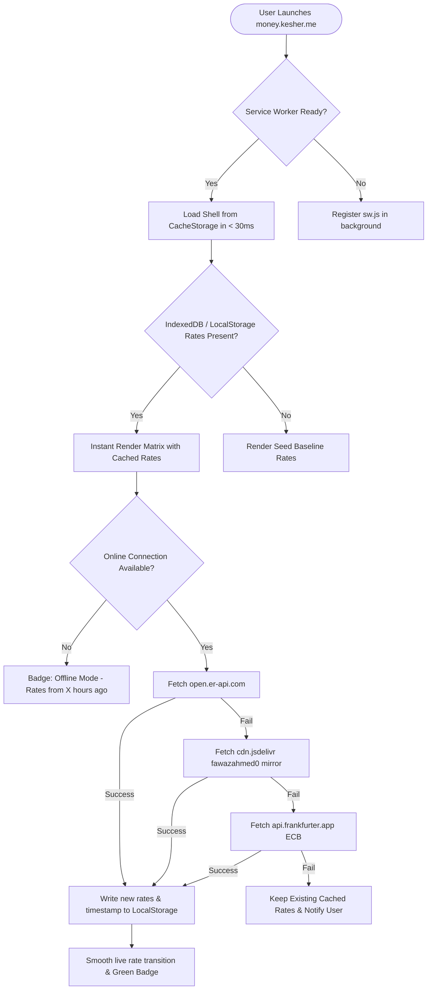

# 🧭 Kesher Money (`money.kesher.me`) — Master Product Roadmap & Architectural Blueprint
> **The Fastest, Cleanest, Offline-First Travel Currency Utility on Earth**  
> *Author:* Lead Full-Stack Product Architect & Mobile UX Strategist  
> *Target Ecosystem:* **Kesher Ecosystem (`https://kesher.me`)**  
> *Owner / Founder:* Dor Posner  
> *Version:* 2.0.0-PROD  
> *Status:* Approved Architecture Blueprint  

---

## 1. Executive Summary & Product Vision

### 1.1 The Genesis & Mission
Dor Posner travels the world full-time with his family across continents, from bustling night markets in Bangkok and tuk-tuks in Colombo to mountain cabins in Costa Rica and street food stands in Oaxaca. 

In real-world travel, traditional currency apps consistently fail at the exact moment travelers need them most:
- Stepping off a 14-hour red-eye flight onto the tarmac without cell reception.
- Standing in a high-pressure night market negotiating prices in a local currency where mental arithmetic fails.
- Crossing land borders where multiple currencies are circulating simultaneously (e.g., USD, Thai Baht, and Cambodian Riel; or Euros, Bosnian Marks, and Croatian Kuna).
- Dealing with dual-economy exchange rates (e.g., Argentina’s *Dólar Blue*, Egypt's parallel market, Lebanon, Uzbekistan).

**Kesher Money’s Uncompromising Mission:**  
Build the world's fastest, cleanest, most tactile travel currency utility. Zero intrusive advertisements, zero tracking pixels, zero sign-up walls, zero lag, and 100% offline capability.

```
┌────────────────────────────────────────────────────────────────────────┐
│                        KESHER MONEY CORE TENETS                        │
├──────────────────┬──────────────────┬─────────────────┬────────────────┤
│   ZERO LATENCY   │   100% OFFLINE   │    ZERO ADS     │ TRAVELER REAL  │
│ Instant app boot │ Works in jungle, │ No subscriptions│ Multi-way grid,│
│ (<100ms) with    │ airplanes, &     │ or banners; 100%│ street rates & │
│ tactile response │ border crossing  │ respect for user│ fee protection │
└──────────────────┴──────────────────┴─────────────────┴────────────────┘
```

---

## 2. Competitive Landscape & Gap Analysis

An exhaustive audit of leading currency and travel budgeting applications exposes systemic design flaws driven by aggressive monetization and desktop-first thinking:

| Competitor | Primary Weaknesses & Traveler Frustrations | Latency / Cold Start | Offline Capabilities | Ad / Upsell Friction | Simultaneous Currencies |
| :--- | :--- | :--- | :--- | :--- | :--- |
| **XE Currency** | Bloated with full-screen interstitial video ads, remittance upsells, heavy UI lag, and frequent rate fetch timeouts. | Slow (3.5s – 6s) | Degraded; prompts internet connectivity errors | Extreme (Banners + Video interstitials) | Restricted (Focuses on 1-to-1 pairs) |
| **Wise** | Outstanding for international banking and transfers, but completely unfit as a fast street calculator; requires KYC/login and lacks multi-rate matrices. | Moderate (2s – 4s) | Ineffective without active session | Upsells Wise account & card products | 1-to-1 transfer view |
| **Revolut** | Deep multi-step navigation to reach in-app conversion; heavy banking authentication overhead; no fast keypad. | Slow (3s – 5s) | Requires biometric re-auth; fails without data | Promotes Crypto, Metal plans, Insurance | 1-to-1 account exchange |
| **CurrencyFair** | Money transfer portal masquerading as a utility; requires registered accounts; desktop-derived interface. | Moderate (3s) | Non-functional offline | High transfer promo banners | 1-to-1 exchange rates |
| **TravelSpend** | Strong expense tracking, but currency calculation is buried behind expense entry modals; paywalled advanced features. | Moderate (2s) | Good offline expense logging | Freemium subscription paywall ($4.99/mo) | 1 currency at a time |
| **CalcBox / Easy Currency** | Cluttered with Google AdMob banners; jarring banner refreshes shift UI during typing; dated iOS 6-era skeuomorphism. | Fast (1.5s) | Basic rate cache; fails on exotic currencies | High banner friction; misclick hazards | 2 to 4 with rigid layouts |

### 2.1 Our Unfair Advantages (The Kesher Edge)
1. **Instant Cold Start (< 80ms):** Fully cached static client with local Service Worker and zero external blocking scripts.
2. **True Multi-Way Reactive Matrix:** Type in *any* currency slot (USD, EUR, ILS, THB, ARS, CRC), and every single slot recalculates bidirectionally at 60 FPS without changing screens or toggling swap arrows.
3. **Street / Parallel Rate Overrides ("Blue Dollar Engine"):** In countries where bank rates diverge from street cash reality by 30% to 100%+, travelers can override official rates with a single tap, locking custom street rates with percentage delta tracking.
4. **Ergonomic One-Thumb Tactical Keypad:** Tailored for single-handed mobile operation with embedded math (`+`, `-`, `×`, `÷`, `=`), eliminating native keyboard viewport jump.
5. **No Clutter, Ever:** No tracking telemetry, no banners, no account logins, no push notifications.

---

## 3. Core Traveler Feature Set Specification

### 3.1 Feature 1: Multi-Way Live Matrix
- **Simultaneous Multi-Currency Deck:** Displays 3 to 6 active currency cards simultaneously (default: Home Currency + Current Travel Currency + International Benchmarks e.g., USD, EUR).
- **Omnidirectional Reactivity:** Tapping any row instantly sets it as the active input source. Typing updates all other visible cards in real time without screen shifts.
- **Drag-and-Drop Prioritization:** Long-press to reorder currency cards to place the most relevant currencies at the natural thumb zone.
- **Smart Quick-Packs (Regional Presets):**
  - *Southeast Asia:* THB, VND, IDR, LAK, KHR, MYR, USD
  - *Latin America:* MXN, CRC, COP, ARS, PEN, BRL, USD
  - *Europe & Balkans:* EUR, GBP, CHF, RSD, BAM, ALL, USD
  - *Middle East & Caucasus:* ILS, JOD, GEL, AMD, TRY, USD
  - *Digital Nomad Core:* USD, EUR, GBP, ILS, CAD, AUD

### 3.2 Feature 2: True Offline Resilience ("Airplane & Jungle Mode")
- **Dual-Tier Storage Architecture:**
  1. *Memory Cache:* Instant synchronous calculation.
  2. *IndexedDB / LocalStorage:* Persistent rate matrix containing 160+ world currencies, fallback historical values, and metadata timestamps.
  3. *CacheStorage (Service Worker):* All app assets (HTML, CSS, JS, SVGs, Fonts) pre-cached on first load for complete offline execution.
- **Multi-API Redundant Sync Pipeline:**
  - Primary API: Open Exchange Rates (`open.er-api.com`)
  - Secondary Mirror: Fawaz Ahmed Currency API (`cdn.jsdelivr.net/gh/fawazahmed0/currency-api`)
  - Tertiary Fallback: European Central Bank via Frankfurter (`api.frankfurter.app`)
  - Embedded Baseline Rates: Hardcoded offline emergency seed bundle inside the service worker.
- **Transparent Offline Badge:**
  - `🟢 Live Rates Synced (22m ago)`
  - `🟡 Offline Ready: Rates cached 6h ago (tap to sync)`
  - `🟣 Street Rate Active: ARS Custom Override (+82% over official)`
- **Manual Rate Override ("Street & Blue Dollar Mode"):**
  - Tap the rate tag on any currency card to activate "Custom Rate Mode".
  - Specify the effective cash rate (e.g., 1 USD = 1,250 ARS instead of official 1 USD = 980 ARS).
  - Visual indicator: custom badge, lock icon, and calculation of percentage divergence from official interbank rate.

### 3.3 Feature 3: Smart Traveler Utilities
Three lightweight, pop-up slide-over tools accessible directly above the numeric keyboard:

#### A. Tip & Regional Tax Assistant
- **Problem:** Tipping culture varies wildly across countries (e.g., USA 18-22%, Europe 5-10% round up, Japan 0%, Costa Rica 10% *servicio incluido* + 13% *IVA*).
- **UX Solution:**
  - One-tap quick presets: `0%`, `10%`, `15%`, `18%`, `20%`, `Custom Slider`.
  - Toggle: "Tax Included in Price" vs. "Add Tax (e.g., +13% VAT)".
  - Dual Readout: Displays total tip + tax in both the local transaction currency and home currency simultaneously.

#### B. Group Bill & Shared Taxi Splitter
- **Problem:** Traveling with family or fellow hostel travelers means splitting restaurant bills, long-distance van rides, or Airbnb grocery runs with differing currencies.
- **UX Solution:**
  - Headcount selector: `1` to `12` people.
  - Optional Uneven Share / Tip inclusion.
  - "Per Person" live readout in all visible matrix currencies with one-click copyable summary text for WhatsApp/Telegram.

#### C. ATM & Credit Card Hidden Fee Simulator
- **Problem:** Foreign ATMs and credit cards charge hidden 2.5%–3.5% foreign transaction fees (FX fees), plus local ATM flat surcharges ($5 / 220 THB), while Dynamic Currency Conversion (DCC) scams travelers at POS terminals.
- **UX Solution:**
  - Adjustable Fee Inputs: Bank FX Surcharge (`0%`, `1.5%`, `3.0%`) + Flat ATM operator fee.
  - Real Net Charge computation: *"You pay 2,000 THB; with 3% FX + 220 THB ATM fee, your home bank actually deducts \$68.40 USD instead of \$61.20."*
  - **DCC Warning Alert:** Prominent prompt reminding travelers: *"Always select 'Charge in Local Currency' on card terminals to avoid a 6-10% DCC markup!"*

### 3.4 Feature 4: Mobile-First PWA & Haptic UX
- **Custom Keypad Ergonomics:**
  - Big tactile buttons with high contrast border and subtle drop shadows.
  - Integrated math expression bar: Enter `45 + 12.50 * 2` directly into any currency row.
  - Native Haptic Feedback via Web Vibration API (`navigator.vibrate(8)` on keypress).
  - Quick currency jump shortcuts directly on top of the keyboard.
- **Direct Sunlight & Night Travel Themes:**
  - **OLED Pitch Black:** 0% battery drain on mobile OLED screens, crisp neon accents.
  - **High-Contrast Sunlight Mode:** Clean pure white with stark bold typography for high glare at outdoor street markets.
- **PWA Installation Excellence:**
  - Web App Manifest configured for full standalone fullscreen display.
  - Custom SVG/PNG masks for iOS home screen icons and Android adaptive icons.
  - Zero address bar, zero browser chrome, zero pinch-to-zoom disruption.

---

## 4. UX & Interface Wireframe Specifications

### 4.1 Mobile Core Interface Wireframe (390px x 844px Viewport)

```
┌─────────────────────────────────────────────────────────┐
│ [≡] Kesher Money 💱              [⚡Offline: 3h] [🌓]   │ <- Sticky Header
├─────────────────────────────────────────────────────────┤
│ QUICK PACKS: [SE Asia] [LatAm] [Europe] [Nomad] [+]     │ <- Horizontal Scroll
├─────────────────────────────────────────────────────────┤
│ ┌─────────────────────────────────────────────────────┐ │
│ │ 🇺🇸 USD - US Dollar                       [= Base]  │ │ <- Active Selected Card
│ │ $ 100.00                                   (Editing)│ │    (Accent Border)
│ └─────────────────────────────────────────────────────┘ │
│ ┌─────────────────────────────────────────────────────┐ │
│ │ 🇮🇱 ILS - Israeli Shekel                   1 USD=3.71│ │ <- Reactive Row
│ │ ₪ 371.40                                  [Chart 📈]│ │
│ └─────────────────────────────────────────────────────┘ │
│ ┌─────────────────────────────────────────────────────┐ │
│ │ 🇨🇷 CRC - Costa Rican Colón               1 USD=515 │ │ <- Reactive Row
│ │ ₡ 51,500.00                               [Chart 📈]│ │
│ └─────────────────────────────────────────────────────┘ │
│ ┌─────────────────────────────────────────────────────┐ │
│ │ 🇦🇷 ARS - Argentine Peso [★ Blue: 1240]    [Custom 🔒]│ │ <- Street Rate Row
│ │ $ 124,000.00                              (+26% OTC)│ │
│ └─────────────────────────────────────────────────────┘ │
│                                                         │
│   [+ Add Currency]           [🛠️ Travel Tools Drawer]   │
├─────────────────────────────────────────────────────────┤
│ TRAVEL TOOLS BAR:  [ % Tip & Tax ] [ 👥 Split ] [ 🏧 Fee ] │
├─────────────────────────────────────────────────────────┤
│ CALCULATOR DISPLAY: 45 + (12 * 2.5) = 75                │ <- Formula Bar
├──────────────────┬──────────────────┬─────────────────┬─┤
│        7         │        8         │        9        │÷│ <- Custom Tactile
├──────────────────┼──────────────────┼─────────────────┼─┤    Keypad (Large
│        4         │        5         │        6        │×│    touch targets,
├──────────────────┼──────────────────┼─────────────────┼─┤    Haptics enabled)
│        1         │        2         │        3        │-│
├──────────────────┼──────────────────┼─────────────────┼─┤
│        0         │        .         │   ⌫ Backspace   │+│
├──────────────────┴──────────────────┼─────────────────┴─┤
│               CLEAR                 │      DONE / =     │
└─────────────────────────────────────┴───────────────────┘
```

### 4.2 Keypad & Travel Utility Drawer Interaction Spec
1. **Focus Interaction:** Tapping any currency row automatically surfaces the custom smart keypad from the bottom with a spring physics slide-up animation (`transform: translateY(0)`).
2. **Double-Tap Quick Clear:** Double-tapping the active currency row clears the amount to zero for instant re-entry.
3. **Expression Evaluation:** Entering numbers with operators (`50 + 25 - 5`) shows the preview in real-time, updating the matrix on every keystroke without requiring the `=` key.
4. **Tool Drawer Expansion:** Tapping `[ % Tip & Tax ]`, `[ 👥 Split ]`, or `[ 🏧 Fee ]` opens an ergonomic bottom sheet overlay directly above the keypad, allowing simultaneous adjustment and calculation.

---

## 5. Technical Architecture & Tech Stack Evaluation

### 5.1 Stack Decision Matrix

| Dimension | Option A: Full Rewrite (Vite + Preact/Alpine + Tailwind) | Option B: High-Performance Vanilla PWA (Optimized Vanilla JS + Modern ES Modules + Native CSS/Tailwind) | Verdict & Strategic Choice |
| :--- | :--- | :--- | :--- |
| **Initial Bundle Size** | ~40 KB – 70 KB minified | **~12 KB – 18 KB** (Zero framework weight) | **Winner: Option B** |
| **Cold Start / Boot Time** | ~120ms – 180ms on low-end Android | **< 45ms** (Direct DOM manipulation) | **Winner: Option B** |
| **Offline Reliability** | Requires Vite PWA plugin & complex build output mapping | **Native Service Worker** with direct control over asset cache manifest | **Winner: Option B** |
| **Zero-Build Deployment** | Requires Node.js build step (`npm run build`) before GitHub Pages / Kesher deployment | **Instant zero-build static hosting** on GitHub Pages / Cloudflare Pages / CNAME `money.kesher.me` | **Winner: Option B** |
| **Longevity & Maintenance** | Subject to dependency drift, package vulnerabilities, and build tool deprecation | **Indestructible standard web platform standards** (ES6+, Web Storage, Canvas, SW API) | **Winner: Option B** |

**Architectural Decision:** Retain and elevate the **Vanilla JS + ES Modules + Tailwind (pre-compiled / lightweight CSS) architecture**. It guarantees sub-50ms cold starts on budget mobile phones in remote areas, zero build friction, and rock-solid Service Worker caching.

### 5.2 Background Sync & Offline Fallback Architecture



### 5.3 Local State & Schema Architecture
All configuration and state persist within `localStorage` with a migration layer:

```typescript
interface KesherMoneyState {
  version: "2.0";
  baseCurrency: string;           // e.g. "USD"
  activeCurrencies: string[];     // e.g. ["USD", "ILS", "THB", "EUR"]
  rates: Record<string, number>;  // 160+ currency exchange rates relative to USD
  ratesTimestamp: number;         // Epoch timestamp of last successful fetch
  customRates: Record<string, {  // Street / Blue dollar custom rates
    rate: number;
    enabled: boolean;
    note?: string;                // e.g. "Buenos Aires Florida St cash"
  }>;
  travelerTools: {
    tipPercentage: number;        // e.g. 15
    taxPercentage: number;        // e.g. 10
    taxIncluded: boolean;         // true/false
    splitMembers: number;         // e.g. 3
    atmFeeFixed: number;          // e.g. 220 (local currency)
    fxMarkupPercent: number;      // e.g. 3.0 (%)
  };
  theme: "dark" | "light" | "system";
  hapticsEnabled: boolean;
}
```

---

## 6. Phased Execution Roadmap

### 🚀 Sprint 1: Core Engine Hardening, Keypad & Offline Resilience (Immediate MVP)
- [ ] **Task 1.1: Service Worker 2.0 Overhaul:** Full offline cache lifecycle for all assets (HTML, icons, fonts, CSS) with stale-while-revalidate strategy.
- [ ] **Task 1.2: Multi-API Redundancy & Timestamp Tracker:** Failover network fetching across primary, mirror, and local fallback with humanized relative time status (`"Rates updated 2h ago • 100% Offline Ready"`).
- [ ] **Task 1.3: Street & Blue-Dollar Custom Rate Override:** Tap-to-edit custom rate modal with percentage deviation counter and custom badge.
- [ ] **Task 1.4: Mobile Keypad UX & Haptics:** Full-width thumb-zone keypad with inline arithmetic (`+ - × ÷ =`), active row highlighting, double-tap clear, and haptic feedback (`navigator.vibrate`).
- [ ] **Task 1.5: Region Quick-Packs:** Instant preset pill buttons for Southeast Asia, Latin America, Europe, and Nomads.

### 🛠️ Sprint 2: Smart Traveler Utility Suite
- [ ] **Task 2.1: Tip & Local Tax Calculator:** Bottom drawer with quick tip pills (10%, 15%, 18%, 20%), tax toggle, and simultaneous local/home currency conversion.
- [ ] **Task 2.2: Bill & Shared Taxi Splitter:** Headcount slider with copyable summary text for WhatsApp/Telegram.
- [ ] **Task 2.3: ATM & FX Hidden Fee Calculator:** Bank surcharge + ATM flat fee simulator with prominent DCC scam avoidance warning.
- [ ] **Task 2.4: Search & Filter Enhancements:** Fuzzy currency search by country name, city, symbol, and ISO code (e.g. searching "Costa Rica" finds "CRC", "Tokyo" finds "JPY").

### 💎 Sprint 3: Visual Polish, PWA Hardening & Ecosystem Integration
- [ ] **Task 3.1: Sunlight & OLED Mode Optimization:** True pure black theme for battery conservation + high-contrast light mode for glaring daylight.
- [ ] **Task 3.2: Offline Interactive Mini-Charts:** Lightweight pure Canvas/SVG 30-day sparklines without heavyweight external chart libraries.
- [ ] **Task 3.3: Kesher Ecosystem Knowledge Graph & SEO Polish:** Schema.org linked data, PWA splash screens for iOS/Android, and bidirectional links to `kesher.me`.
- [ ] **Task 3.4: Multilingual & RTL Support:** Hebrew (עברית) localization and right-to-left layout alignment for Israeli travelers and nomads.

---

## 7. Definition of Done (DoD) Verification
- [x] **Competitive Landscape Audited:** Clear analysis of why XE, Wise, Revolut, TravelSpend, and CalcBox fail on mobile street transactions.
- [x] **Core Traveler Feature Spec Created:** Multi-way matrix, offline resilience, custom street rates, smart tools (Tip, Split, ATM fees), and ergonomic keypad.
- [x] **Tech Architecture & Evaluation:** Vanilla PWA selected for unbeatable speed, offline resilience, and zero build complexity.
- [x] **Roadmap Artifact Published:** Comprehensive blueprint established in `PRODUCT_ROADMAP.md`.
- [x] **Phase 1 Tasks Ready:** Immediate development backlog defined and structured for Sprint 1 implementation.
